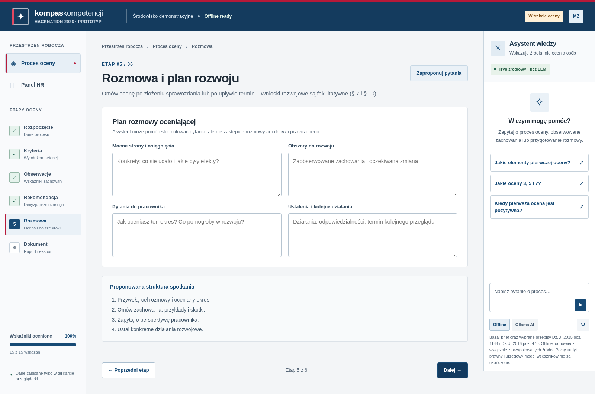

**Aktualna wersja: v0.6.5.** Numer wydania jest widoczny w górnym pasku obok nazwy projektu. Zmiana numeru: `index.html` → `meta[name="kompas-version"]`; nagłówek i tytuł karty aktualizują się automatycznie.

## Focused UX — v0.6.2

W tej wersji **Asystent wiedzy** otwiera się przyciskiem **Asystent** w nagłówku. Domyślnie jest zwinięty, aby nie zasłaniał procesu oceny. `Escape` zamyka panel; podczas testu scenariusza `Asystent wiedzy` otwiera się automatycznie. Opis ograniczeń prototypu jest zwięzły i rozwijany przyciskiem **Szczegóły**. Menu **Scenariusze testowe** nadal jest dostępne na pierwszym etapie.

**Publikacja:** kod jest utrzymywany w repozytorium GitHub. Po aktualizacji sprawdź numer wersji na stronie demonstracyjnej. Zob. [testy i układ](docs/UX-FOCUSED.md).

## Scenariusze testowe (v0.6.2)

W kroku **Rozpoczęcie** wybierz **Scenariusze testowe**. Menu obejmuje pięć fikcyjnych przypadków, wyników nie symuluje: sprawdza je istniejący silnik. **Przywróć sesję** odtwarza dane sprzed demonstracji. [Instrukcja dla jury](docs/TESTING-GUIDE.md).

**AI Online:** Worker jest skonfigurowany, a użytkownik potwierdził działanie pytań testowych w przeglądarce. Nie przesyłaj danych rzeczywistych pracowników.

# Kompas Kompetencji

**Prototyp konkursowy HackNation 2026 — zadanie „Kompas Kompetencji” (Ministerstwo Cyfryzacji).**

[**Uruchom demonstrację w przeglądarce**](https://hckntn.github.io/kompas-kompetencji/)

Kompas Kompetencji to aplikacja wspierająca przełożonych w prowadzeniu ocen pracowników służby cywilnej. Łączy uporządkowany proces, pomocnicze wskaźniki zachowań, reguły oceny, przygotowanie rozmowy oraz roboczą dokumentację. **Oceny cząstkowe wybiera przełożony — aplikacja nie zastępuje jego decyzji.**

> **Status: v0.6.5 — prototyp demonstracyjny z Online AI, scenariuszami testowymi i stabilnym panelem asystenta.** Użytkownik potwierdził działanie odpowiedzi Online AI i testowych pytań w opublikowanej wersji v0.6.4 (22.11.2026). Nie jest to oficjalny system administracji publicznej ani narzędzie dopuszczone do oceny rzeczywistych pracowników. Wszystkie dane przykładowe są fikcyjne.



## Jak przetestować demo

1. Otwórz [wersję online](https://hckntn.github.io/kompas-kompetencji/) na komputerze.
2. Wybierz **„Scenariusze testowe → Pierwsza ocena — pozytywna”**.
3. Przejdź przez sześć etapów: **Rozpoczęcie → Kryteria → Obserwacje → Rekomendacja / decyzja → Rozmowa → Dokument**.
4. Sprawdź pięć elementów pierwszej oceny i oceny cząstkowe **3 / 5 / 7**, które wybiera przełożony.
5. Zapoznaj się z wynikiem i warunkami formalnymi, a następnie wygeneruj **raport roboczy** (druk / zapis do PDF albo eksport JSON/TXT).

Scenariusz **„Ocena okresowa — demo”** uruchamia drugą ścieżkę, która pozostaje **demonstracyjna**.

## Co działa w wersji v0.5 (na bazie v0.4)

- **Workflow Engine** — prowadzenie przez etapy, walidacja przejść, stan procesu i historia techniczna.
- **Pierwsza ocena** — pięć elementów wskazanych w rozporządzeniu z 23 lipca 2015 r. (Dz.U. 2015 poz. 1144).
- **Formalne oceny 3/5/7** — oddzielne od demonstracyjnej skali obserwacji 1–4; obliczanie średniej i sprawdzanie wybranych warunków wyniku.
- **Decyzja przełożonego** — wybór ocen cząstkowych, informacje dotyczące egzaminu i sprawozdania, uzasadnienie wyniku negatywnego.
- **Wsparcie rozmowy**, roboczy raport PDF oraz eksport JSON i TXT.
- **Demonstracyjny panel HR** i asystent informacyjny oparty na przygotowanych odpowiedziach i źródłach ELI/KPRM.
- **Praca lokalna** — HTML, CSS i JavaScript bez serwera i instalacji zależności w podstawowym scenariuszu.

## Ważne ograniczenia

- Opisy zachowań oraz skala obserwacji 1–4 są **pomocnicze i demonstracyjne**; nie zastępują oficjalnego modelu wskaźników.
- Aplikacja nie tworzy jeszcze oficjalnych wzorów arkusza pierwszej oceny i formularza sprawozdania. PDF jest **raportem roboczym**, nie dokumentem do akt osobowych.
- **Ocena okresowa nie jest jeszcze w pełni zgodna z wymaganiami rozporządzenia z 2016 r.** — służy do demonstracji przebiegu procesu.
- Podstawowy asystent działa w trybie **odpowiedzi źródłowych offline, bez generatywnej LLM**. Integracja z lokalną Ollama jest opcjonalna i nie stanowi zweryfikowanego doradztwa prawnego.
- Nie ma produkcyjnego systemu uprawnień, zabezpieczonej bazy kadrowej, integracji EZD/QNT ani pełnej obsługi wyjątków proceduralnych.
- **Nie należy wprowadzać prawdziwych danych osobowych.** Stan demonstracji jest przechowywany w sesji przeglądarki.

Szczegółowa lista wdrożonych funkcji i braków znajduje się w [docs/DOMAIN-COMPLIANCE.md](docs/DOMAIN-COMPLIANCE.md) (obecnie dokument roboczy w języku rosyjskim).

## Tryb AI Online — nowość w v0.6

Dodano połączenie z generatywnym modelem językowym przez **Cloudflare Worker + Gemini API** z kluczem wyłącznie po stronie Workera. Adres Workera został skonfigurowany w `data/online-config.js`: `https://kompas-kompetencji-ai.hckntn.workers.dev`. Klucz znajduje się tylko w Cloudflare Secrets. **Ta paczka nie została jeszcze opublikowana na GitHub Pages.**

Asystent wymaga wyraźnej zgody na przekazanie pytania do zewnętrznego dostawcy AI. Aplikacja nie dołącza automatycznie danych z oceny pracownika, a serwer samodzielnie wybiera dopuszczone materiały źródłowe. System nie nadaje się do przetwarzania rzeczywistych danych osobowych: filtr PII nie jest niezawodny, a bezpłatne API może używać danych do ulepszania produktów.

**Weryfikacja:** 22.11.2026 wykonano dwa ręczne zapytania z przeglądarki: o elementy pierwszej oceny oraz przygotowanie rozmowy. Oba zwróciły HTTP 200, `fallback: false`; integracja w nowym interfejsie wymaga testu po publikacji. Pełna instrukcja: [docs/ONLINE-AI.md](docs/ONLINE-AI.md).

## Test asystenta AI WebGPU (eksperymentalnie)

1. Otwórz aplikację na komputerze w aktualnym Chrome lub Edge z obsługą WebGPU.
2. Naciśnij **Asystent** w nagłówku. W panelu **Asystent wiedzy** wybierz **AI WebGPU**, a następnie **Uruchom AI w przeglądarce**.
3. Przy pierwszym uruchomieniu potrzebny jest internet i pobranie dużych plików modelu; nie wymagamy kluczy API ani płatnych usług.
4. Zapytaj np. **„Jakie elementy pierwszej oceny?”** lub **„Jak przygotować rozmowę z pracownikiem?”**. Odpowiedzi AI są oznaczone jako wygenerowane i powiązane z kontekstem źródłowym.
5. Pytanie bez potwierdzonego źródła powinno zostać odrzucone **bez uruchamiania LLM**. Gdy model jest niedostępny, można wrócić do **Offline**.

**Weryfikacja:** testy automatyczne obejmują sterowanie modelem i odpowiedzi z testowym adapterem, ale nie potwierdzają pobrania modelu i generacji na GPU w przeglądarce jury. Zob. [AI-ASSISTANT.md](docs/AI-ASSISTANT.md).

## Uruchomienie lokalne

1. Wybierz w repozytorium **Code → Download ZIP** i rozpakuj archiwum.
2. Otwórz **index.html** na komputerze w Chrome, Edge lub Firefox.
3. Uruchom przygotowany scenariusz pierwszej lub okresowej oceny.

Podstawowe działanie nie wymaga internetu, konta ani Node.js. Ollama to opcjonalny tryb wymagający osobnej konfiguracji lokalnej.

## Architektura

Projekt używa **vanilla JavaScript, HTML i CSS**, bez frameworka i procesu budowania. Logika domenowa, wykonywanie procedur i interfejs zostały rozdzielone:

| Plik / katalog | Rola |
| --- | --- |
| `data/first-rules.js` | Wybrane formalne reguły pierwszej oceny |
| `data/procedures.js`, `data/competencies.js` | Definicje ścieżek i kryteriów |
| `js/workflow.js`, `js/validation.js`, `js/assessment.js`, `js/session.js` | Silnik procesu |
| `js/assistant.js`, `js/online-ai.js` | Asystent źródłowy, adapter Online AI i opcjonalne tryby eksperymentalne |
| `js/app.js`, `assets/` | Interfejs Gov.pl-inspired Institutional UI |

Dokumentacja, scenariusz demo i historia zmian: katalog `docs/` i [CHANGELOG.md](CHANGELOG.md).

## Testy

Repozytorium zawiera testy jednostkowe i przeglądarkowe:

```bash
node tests/core.test.cjs
node tests/ai.test.cjs
node worker/test.mjs
python tests/test_online_ui.py
python tests/test_e2e.py
python tests/test_institutional_ui.py
python tests/test_focused_ux.py
```

Narzędzia testowe wymagają Node.js oraz środowiska Python/Playwright/Chromium; nie są potrzebne do uruchomienia samej aplikacji.

## Źródła

- [ELI — Dz.U. 2015 poz. 1144, pierwsza ocena](https://eli.gov.pl/api/acts/DU/2015/1144/text.html)
- [KPRM — Pierwsza ocena i służba przygotowawcza](https://www.gov.pl/web/sluzbacywilna/pierwsza-ocena)
- [ELI — Dz.U. 2016 poz. 470, ocena okresowa](https://eli.gov.pl/api/acts/DU/2016/470/text.html)
- [KPRM — Ocena okresowa](https://www.gov.pl/web/sluzbacywilna/ocena-okresowa)

**Kolejne kroki:** wdrożenie i weryfikacja Online AI na osobnym adresie, integracja oficjalnych wskaźników i formularzy, pełna ścieżka oceny okresowej, weryfikowalny asystent LLM z odwołaniami do źródeł oraz model bezpieczeństwa i uprawnień.

Materiały konkursowe: [opis wyzwania](references/opis-wyzwania.pdf), [regulamin](references/regulamin-zadania.pdf).


### v0.6.3 — stabilny układ asystenta

Tryb AI wybiera się z listy w nagłówku panelu, niezależnie od położenia edytora wiadomości. Zgoda AI Online, ustawienia Ollama oraz uruchamianie WebGPU są dostępne w osobnym oknie. Przycisk **Wyczyść rozmowę** kasuje tylko historię chatu z lokalnej sesji, nie rusza danych oceny. Eksport rozmowy nie jest wymagany w briefie konkursowym i nie został wprowadzony ze względów minimalizacji danych.
