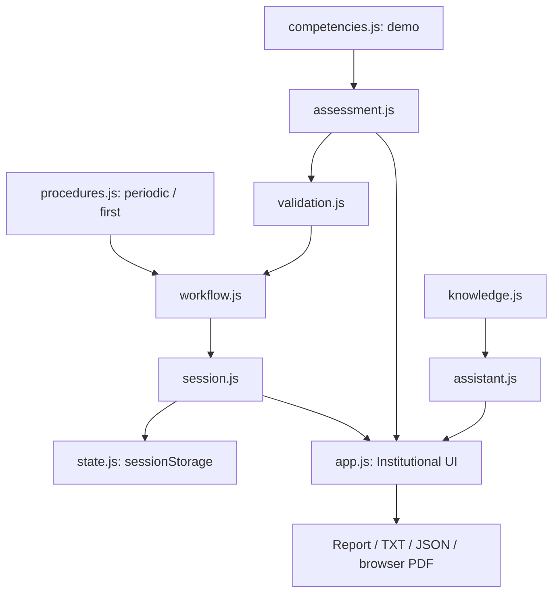

> **v0.4:** добавлен модуль `data/first-rules.js` для первой оценки. Полный список актуальных ограничений приведён в `docs/DOMAIN-COMPLIANCE.md`.

# Архитектура Kompas v0.3

`Kompas` — локальное специализированное приложение для демонстрационного guided workflow, концептуально сходное с Script-mod-flow. Код Script Runner не заимствован.

`engine.js` — только совместимый фасад `assessment`/`workflow` для существующих компонентов интерфейса.

Выполнение и проверки отделены от DOM. Все правила первой/периодической оценки задаются описаниями шагов с проверками `requires`. Окончательный уровень оценки выбирает только руководитель. Возврат на этапы не сбрасывает данные, а изменение ответа очищает зависимое решение, если требуется.

Движок не зависит от AI; AI-консультант остаётся отдельным модулем. Для расчётов используются воспроизводимые арифметические правила демонстрационного каталога. Состояние не является защищённым или серверно валидируемым.

Перенос в реальное кадровое ПО потребует официальных правил KPRM, защищённого бэкенда, аутентификации и RBAC, аудита, правильных форм PDF и юридической проверки. Подробнее: `docs/ENGINE.md`.
